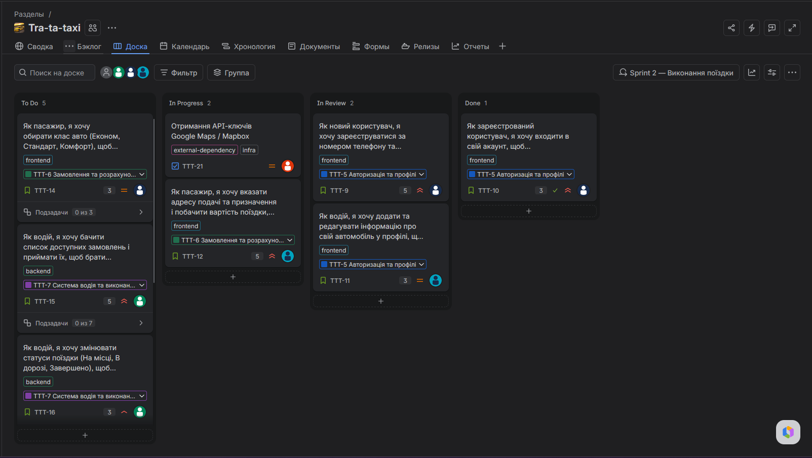
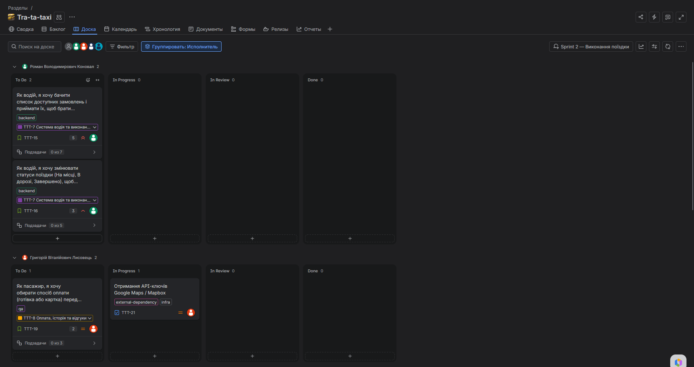
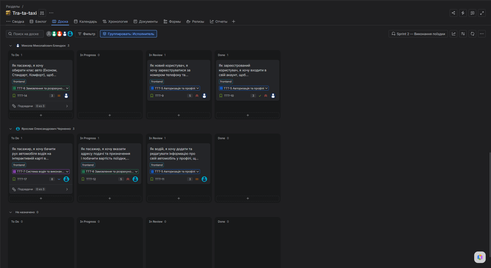
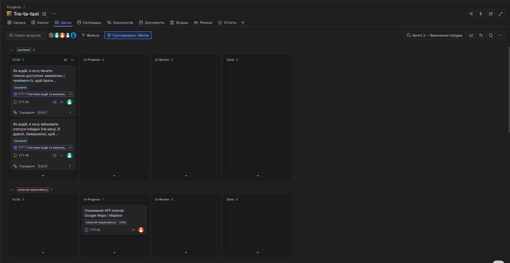
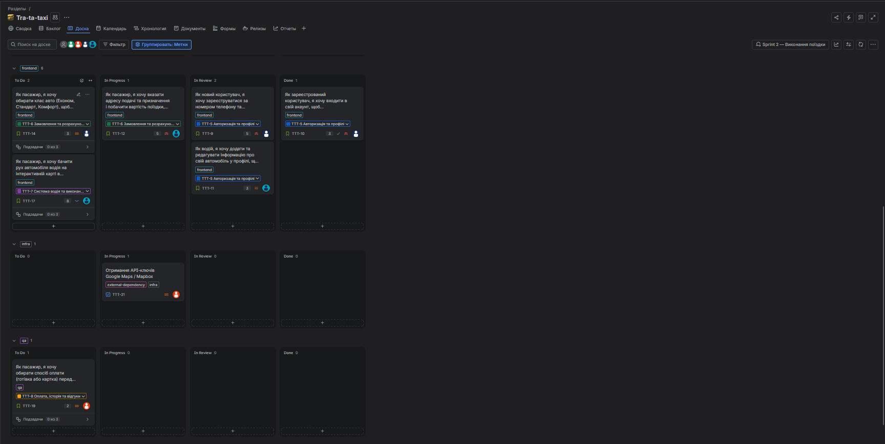
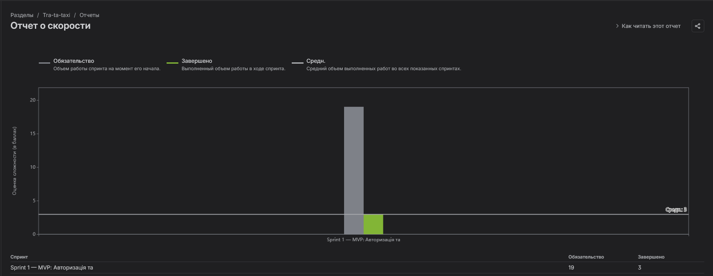
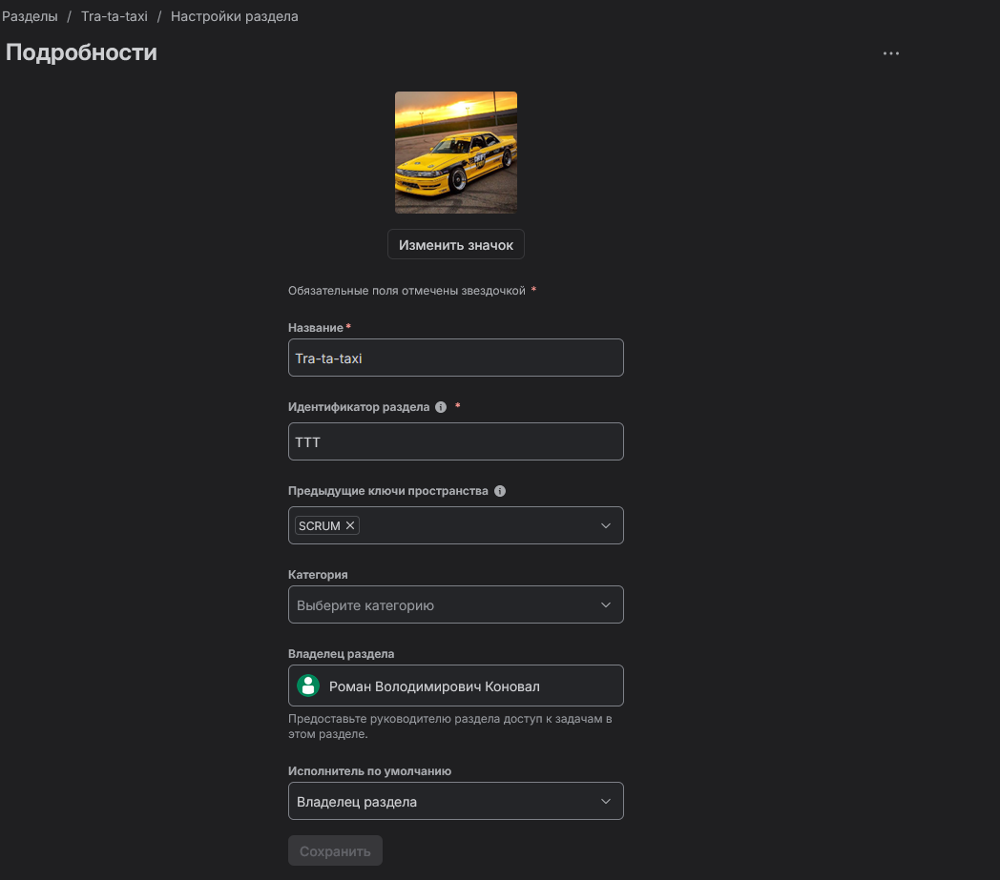

# Управління ресурсами проекту Tra-ta-taxi

**Команда:** Коновал Роман, Блиндюк Микола, Черненко Ярослав, Лисовець Григорій, Яковець Артем | **Jira:** https://nubip-team-rjfeaidz.atlassian.net/jira/software/projects/TTT/boards/1 | **Дата:** 22.11.2026

---

## 2.1. Склад команди

| Учасник | Ролі в проекті | Доступність (FTE) | Годин на тиждень |
|---------|----------------|:-----------------:|:----------------:|
| Коновал Роман | PM + Backend | 0.40 | 16 |
| Блиндюк Микола | Team Lead + Frontend | 0.40 | 16 |
| Черненко Ярослав | UI/UX Designer + Frontend | 0.30 | 12 |
| Яковець Артем | Business Analyst + QA | 0.30 | 12 |
| Лисовець Григорій | Product Owner + Infra | 0.25 | 10 |
| **Разом** | | **1.65 FTE** | **66 год/тиждень** |

---

## 2.2. Capacity на спринт

| Параметр | Значення | Коментар |
|----------|:--------:|----------|
| Тривалість спринту | 2 тижні | Стандартний спринт у Jira |
| Σ годин команди на спринт | 132 год | 66 год/тиждень × 2 тижні (з таблиці 2.1) |
| Коефіцієнт на непродуктивний час (мітинги, рев'ю) | −20% | −26.4 год на планування, дейлі, рев'ю та ретро |
| **Ефективна Capacity** | **105.6 год** | 132 год × 0.8 |
| Velocity (факт, Sprint 1) | 3 SP | З Velocity report (формально закрито лише TTT-13) |
| Годин на 1 SP (оцінка за Subtasks) | 4.62 год/SP | З Лаб 5 (97 год ÷ 21 SP декомпозованих задач) |
| **Плановий обсяг наступного спринту** | **22–23 SP** | 105.6 год ÷ 4.62 год/SP (реалістичний обсяг на Sprint 3) |

---

## 2.3. Skills Matrix

Оцінка навичок: `0` — немає, `1` — базовий, `2` — впевнений, `3` — сильний.

| Навичка | Роман | Микола | Ярослав | Артем | Григорій | Потрібний рівень | Ризик |
|---------|:-----:|:------:|:-------:|:-----:|:--------:|:----------------:|:-----:|
| React / Frontend | 2 | 3 | 2 | 1 | 1 | ≥2 | 🟢 Низький |
| Node.js / Backend | 3 | 2 | 0 | 1 | 1 | ≥2 | 🟡 Середній |
| Бази даних | 3 | 1 | 0 | 2 | 1 | ≥2 | 🟡 Середній |
| Тестування (QA) | 2 | 2 | 1 | 3 | 2 | ≥1 | 🟢 Низький |
| DevOps / Деплой | 2 | 1 | 0 | 0 | 2 | ≥1 | 🟡 Середній |
| Дизайн / Figma | 1 | 1 | 3 | 1 | 1 | ≥1 | 🔴 Високий (Bus Factor = 1) |
| Git / Code Review | 3 | 3 | 2 | 2 | 2 | ≥2 | 🟢 Низький |

---

## 2.4. Аналіз Skills Matrix

| Питання | Відповідь |
|---------|-----------|
| Яка навичка покрита лише однією людиною? | **Дизайн / Figma** на сильному рівні (оцінка 3) покрита лише Ярославом Черненком; **Node.js / Backend** на рівні 3 має лише Роман Коновал. |
| Який Bus Factor у критичних зонах? | У зонах `design` та `backend` Bus Factor дорівнює **1** (вибуття основного виконавця затримає створення нових інтерфейсів та серверної логіки). У зонах `frontend` та `qa` Bus Factor дорівнює **2–3**. |
| Яка навичка потрібна, але відсутня/слабка? | **DevOps / Деплой (`infra`)** та інтеграція зовнішніх сервісів (карти, платіжний шлюз) — у більшості команди рівень `0–1`, лише у Романа та Григорія рівень `2`. |
| План закриття розриву (хто що вчить, до якого спринту) | До початку **Sprint 3**: 1) Микола Блиндюк поглиблює роботу з БД та REST API (`backend`) у парі з Романом під час Code Review; 2) Роман та Микола освоюють базову збірку екранів у Figma за UI-кітом Ярослава; 3) Григорій Лисовець разом із Романом налаштовує тестове середовище та API-ключі (`infra`). |

---

## 2.5. Зони відповідальності (Labels)

*(Кількість задач відповідає точному результату JQL-фільтру `project = TTT AND labels = <label>`)*

| Label | Area Lead | К-сть задач | Що входить |
|-------|-----------|:-----------:|------------|
| `frontend` | Блиндюк Микола / Черненко Ярослав | 16 | UI, форми, екрани пасажира та водія, анімація карти |
| `backend` | Коновал Роман | 12 | API, БД, бізнес-логіка, авторизація, статуси поїздки |
| `qa` | Яковець Артем | 8 | Тестування сценаріїв, перевірка Acceptance Criteria |
| `design` | Черненко Ярослав | 1 | Макети карток замовлення та візуальні компоненти (`TTT-30`) |
| `infra` | Лисовець Григорій | 1 | Отримання API-ключів Google Maps / Mapbox (`TTT-21`) |

---

## 2.6. Аналіз Workload (з Jira)

*(Дані за активним спринтом `Sprint 2 — Виконання поїздки` та результатами `Sprint 1`)*

| Учасник | Задач у спринті (Sprint 2) | SP committed (Sprint 2) | SP done (Sprint 1) | % виконання (Sprint 1) | Висновок |
|---------|:--------------------------:|:-----------------------:|:------------------:|:----------------------:|----------|
| Коновал Роман | 9 (2 Stories, 7 Subtasks) | 8 SP (40h у Subtasks) | 3 SP (`TTT-13`) | 100% (3/3 SP) | Високе технічне навантаження на бекенд (40 год у підзадачах), єдиний виконавець із закритим Story у Sprint 1 |
| Ярослав Черненко | 8 (3 Stories, 5 Subtasks) | 16 SP (20h у Subtasks) | 0 SP (8 SP у роботі/перевірці) | 0% (0/8 SP) | Перевантажений за кількістю Story Points (16 SP) через перенесення `TTT-11` і `TTT-12` та додавання `TTT-17` (8 SP) |
| Блиндюк Микола | 5 (3 Stories, 2 Subtasks) | 11 SP (16h у Subtasks) | 0 SP (8 SP у перевірці/To Do) | 0% (0/8 SP) | Оптимальне навантаження за годинами (16h), відповідає за авторизацію (`TTT-9`, `TTT-10`) та вибір класу авто (`TTT-14`) |
| Яковець Артем *(Unassigned `qa`)* | 8 (1 Story, 7 Subtasks) | 2 SP (21h у Subtasks) | 0 SP | — | 8 задач із міткою `qa` (`TTT-19` та 7 QA-підзадач на 21 год) очікують закріплення за тестувальником |
| Лисовець Григорій *(Unassigned `infra`)* | 1 (`TTT-21`) | 0 SP (Task) | 0 SP | — | Відповідає за зовнішню інфраструктурну задачу `TTT-21` (API-ключі карт) та пріоритизацію як PO |

---

## 2.7. Вирівнювання завантаження

| Виявлена проблема | Рішення | Результат |
|-------------------|---------|-----------|
| Перевантаження Ярослава Черненка за обсягом історій у Sprint 2 (16 SP: `TTT-11`, `TTT-12`, `TTT-17`) та поєднання функцій `frontend` і `design` | Передати частину фронтенд-історій (`TTT-17` на 8 SP) Area Lead зони `frontend` Миколі Блиндюку, залишивши Ярославу дизайн (`TTT-30`) та верстку (`TTT-11`, `TTT-12`) | Вирівнювання навантаження між двома фронтенд-розробниками в межах ±10% від їхнього FTE |
| 9 задач (`8` із міткою `qa` на 21 год та `1` з міткою `infra`) залишаються `Unassigned` в Jira | Призначити виконавцем усіх задач із міткою `qa` Яковця Артема, а задачі `TTT-21` (`infra`) — Лисовця Григорія | 100% задач мають відповідального виконавця відповідно до своєї зони |
| Загальний обсяг активного Sprint 2 становить 37 SP (через перенесення 16 SP зі Sprint 1), що перевищує ефективну Capacity (22–23 SP) | У першу чергу закрити 4 перенесені історії (`TTT-9`, `TTT-10`, `TTT-11`, `TTT-12`), три з яких уже перебувають у статусах *В работе* та *В процессе проверки* | Зниження ризику повторного зриву термінів релізу `v1.0-MVP` |

---

## 2.8. Ресурсний план по спринтах

| Спринт | Період | Потрібні зони | Capacity (год) | Особливості |
|--------|--------|---------------|:--------------:|-------------|
| Sprint 2 (активний) | 22.11.2026 — 06.12.2026 | `backend`, `frontend`, `design`, `qa`, `infra` | 105.6 год | Закриття перенесених задач авторизації/розрахунку (`16 SP`) + базовий функціонал водія (`v1.0-MVP`) |
| Sprint 3 | 07.12.2026 — 21.12.2026 | `backend`, `frontend`, `qa`, `infra` | 90.0 год | Період заліків/модульного контролю (−15% доступності); фіналізація та деплой `v1.0-MVP` (дедлайн Roadmap 22.12.2026) |
| Sprint 4 | 22.12.2026 — 05.01.2027 | `frontend`, `design`, `qa` | 85.0 год | Зимова сесія та свята; реалізація функціоналу релізу `v1.1` (`TTT-18`, `TTT-19`, `TTT-20`) |

---

## 2.9. Скріншоти з Jira

### 1. Backlog з Labels

### 2. Board по Assignee

### 3. Board по Labels

### 4. Velocity report

### 5. Details → Default assignee

---

## 2.10. Висновки команди

- **Хто у команді перевантажений/недовантажений і чому?** Найбільше навантаження мають `backend` (Роман — 40 год у підзадачах) та `frontend` (Ярослав — 16 SP і Микола — 11 SP), оскільки основний обсяг робіт MVP припадає на створення API, авторизації, розрахунку маршруту та інтерфейсів замовлення. Зони `design` (1 задача) та `infra` (1 задача) мають найменше задач, тому ці учасники підключаються до верстки UI та управління беклогом.
- **Який Bus Factor і як його підвищуємо?** У критичних зонах `backend` та `design` Bus Factor дорівнює 1. Ми підвищуємо його через взаємне Code Review між Романом, Миколою та Ярославом, ведення документації API та використання єдиного UI-кіта у Figma для всіх фронтенд-розробників.
- **Чи реалістична запланована кількість SP на наступний спринт при поточній Capacity?** При ефективній Capacity **105.6 год** на спринт (за коефіцієнта `4.62 год/SP`) команда здатна стабільно виконувати **22–23 SP**. Поточний обсяг Sprint 2 у **37 SP** є напруженим через перенесення 16 SP зі Sprint 1, але оскільки більшість перенесених задач уже на стадії перевірки (*In Review*), їх закриття є реалістичним.
- **Яка зона має найбільше задач і чи відповідає це кількості людей у ній?** Найбільше задач у зонах `frontend` (16 задач) та `backend` (12 задач). Це відповідає ресурсам команди: у фронтенді працюють двоє учасників (Микола з 0.40 FTE та Ярослав із 0.30 FTE), а в бекенді — Роман із максимальним залученням (0.40 FTE / 16 год на тиждень).
