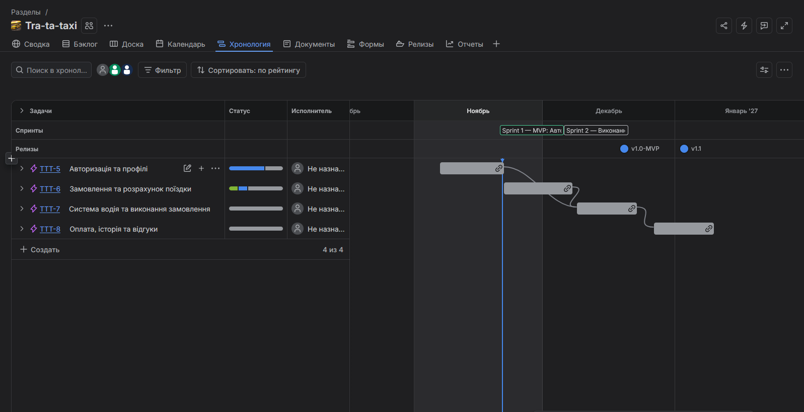
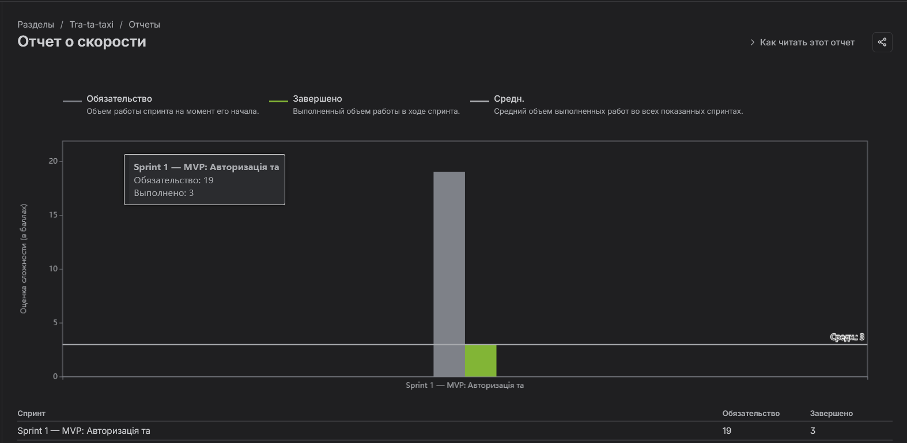
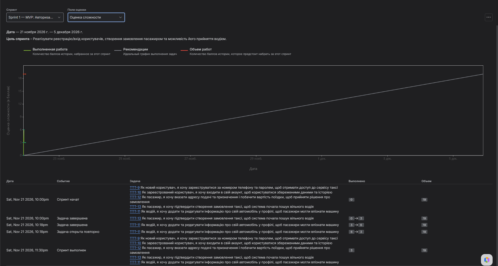
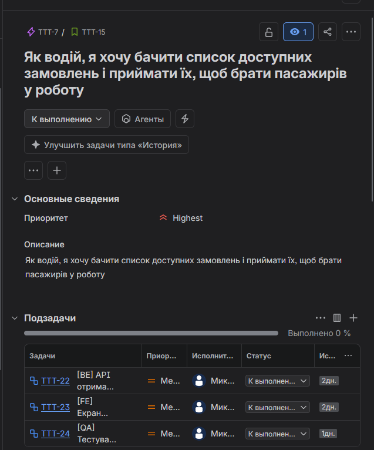
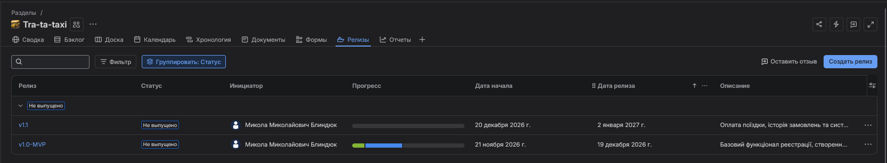

# План часу та вартості проекту Tra-ta-taxi

**Команда:** Коновал Роман, Блиндюк Микола, Черненко Ярослав, Лисовець Григорій, Яковець Артем | **Jira:** https://nubip-team-rjfeaidz.atlassian.net/jira/software/projects/TTT/boards/1 | **Дата:** 21.11.2026

---

## 1. Вихідні дані з Jira

| Параметр | Значення | Джерело в Jira |
|----------|:--------:|----------------|
| Загальний обсяг беклогу | 45 SP | Backlog → сума SP |
| Velocity Sprint 1 | 3 SP | Reports → Velocity Chart (завершено TTT-13) |
| Кількість членів команди | 5 | Project → People |
| Годин у спринті на особу | 40 год | 2 тижні × 5 днів × 4 год |
| Годин на 1 SP | 4.62 год | Σ Original Estimate декомпозованих Stories Sprint 2 (97 год) ÷ 21 SP |
| Погодинна ставка | $15 | Умовна |

---

## 2. Критичний ланцюжок

| # | Issue Key | Story | SP | Блокує |
|:-:|-----------|-------|:--:|--------|
| 1 | TTT-9 | Як новий користувач, я хочу зареєструватися за номером телефону та паролем | 5 | TTT-10 |
| 2 | TTT-10 | Як зареєстрований користувач, я хочу входити в свій акаунт | 3 | TTT-13 |
| 3 | TTT-12 | Як пасажир, я хочу вказати адресу подачі та призначення і побачити вартість (заблоковано зовнішньою задачею TTT-21) | 5 | TTT-13 |
| 4 | TTT-13 | Як пасажир, я хочу підтвердити створення замовлення таксі | 3 | TTT-15 |
| 5 | TTT-15 | Як водій, я хочу бачити список доступних замовлень і приймати їх | 5 | TTT-16 |
| 6 | TTT-16 | Як водій, я хочу змінювати статуси поїздки (На місці, В дорозі, Завершено) | 3 | TTT-17, TTT-19, Release v1.0-MVP |
| | **Разом** | | **24 SP** | |

| Epic / Story з резервом часу (Float) | Чому не на критичному шляху |
|--------------------------------------|----------------------------|
| TTT-11 (Профіль авто), TTT-14 (Вибір класу авто) | Не блокують базовий сценарій створення та прийняття замовлення, можуть виконуватися паралельно |
| TTT-18, TTT-19, TTT-20 (Епік «Оплата, історія та відгуки») | Віднесені до релізу `v1.1` (7 SP), не впливають на запуск базового MVP (`v1.0-MVP`) |

---

## 3. Прогноз тривалості

| Показник | Формула | Значення |
|----------|---------|:--------:|
| Кількість спринтів | 45 SP ÷ 3 SP | 15.0 |
| Округлено | ↑ | 15 спринтів (за фактичним Velocity Sprint 1) |
| Дата початку проєкту (Roadmap) | з Jira (старт TTT-5) | 07.11.2026 |
| Дата релізу v1.0-MVP | згідно з Roadmap (завершення TTT-7) | 22.12.2026 |
| Дата релізу v1.1 | згідно з Roadmap (завершення TTT-8) | 09.01.2027 |
| Чи вкладаємось у семестр? | | Так (реліз `v1.0-MVP` на 38 SP завершується 22.12.2026 до кінця семестру за умови закриття перенесених задач у Sprint 2) |

---

## 4. Вартість команди

| Показник | Формула | Значення |
|----------|---------|---------:|
| Team Cost per Sprint | 5 осіб × 40 год × $15 | $3,000.00 |
| Вартість 1 SP | $3,000.00 ÷ 3 SP | $1,000.00 |
| Вартість 1 години | ставка | $15.00 |

---

## 5. Вартість по Epics

| Epic | Issue Key | SP | Вартість | Fix Version | Період на Roadmap |
|------|-----------|:--:|---------:|-------------|-------------------|
| Авторизація та профілі | TTT-5 | 11 | $11,000.00 | v1.0-MVP | 07.11.2026 — 21.11.2026 |
| Замовлення та розрахунок поїздки | TTT-6 | 11 | $11,000.00 | v1.0-MVP | 22.11.2026 — 07.12.2026 |
| Система водія та виконання замовлення | TTT-7 | 16 | $16,000.00 | v1.0-MVP | 09.12.2026 — 22.12.2026 |
| Оплата, історія та відгуки | TTT-8 | 7 | $7,000.00 | v1.1 | 27.12.2026 — 09.01.2027 |
| **Разом** | | **45** | **$45,000.00** | | |

---

## 6. Бюджет проекту

| Компонент | Розрахунок | Сума |
|-----------|-----------|-----:|
| Оцінка беклогу | 45 SP × $1,000.00 | $45,000.00 |
| Contingency Reserve | 10% від оцінки | $4,500.00 |
| **Working Budget** | $45,000.00 + $4,500.00 | **$49,500.00** |
| Management Reserve | 15% від Working Budget | $7,425.00 |
| **Total Budget** | $49,500.00 + $7,425.00 | **$56,925.00** |

---

## 7. Earned Value за Sprint 1

| Метрика | Розрахунок | Значення | Джерело в Jira |
|---------|-----------|---------:|----------------|
| PV | 19 SP × $1,000.00 | $19,000.00 | Sprint Report → Committed |
| EV | 3 SP × $1,000.00 | $3,000.00 | Sprint Report → Completed |
| AC | 5 осіб × 40 год × $15 | $3,000.00 | Фактично витрачений час команди |
| **CV** | $3,000.00 − $3,000.00 | $0.00 | |
| **SV** | $3,000.00 − $19,000.00 | -$16,000.00 | |
| **CPI** | $3,000.00 ÷ $3,000.00 | 1.00 | |
| **SPI** | $3,000.00 ÷ $19,000.00 | 0.16 | |
| **EAC** | $56,925.00 ÷ 1.00 | $56,925.00 | |

| Індекс | Значення | Стан | Інтерпретація |
|--------|:--------:|:----:|---------------|
| CPI | 1.00 | 🟢 | Витрати за спринт відповідають плановому ліміту годин команди |
| SPI | 0.16 | 🔴 | Відставання за графіком у Sprint 1: формально в Done переведено лише 1 задачу (3 SP), а 4 задачі (16 SP) перенесено у Sprint 2 |

> 🟢 ≥ 1.0 | 🟡 0.9–1.0 | 🔴 < 0.9

---

## 8. Скріншоти

### 1. Roadmap з залежностями між Epics

### 2. Velocity Chart

### 3. Burndown Chart Sprint 1

### 4. Story з Subtasks і Time Tracking

### 5. Releases (v1.0-MVP, v1.1)

---

## 9. Рефлексія

| Питання | Відповідь команди |
|---------|------------------|
| Наскільки оцінка в годинах (Subtasks) збіглась зі Story Points? Який коефіцієнт вийшов? | Після декомпозиції 5 історій Sprint 2 (`21 SP`) на 21 технічну підзадачу (`[BE]`, `[FE]`, `[QA]`, `[Design]`) сума оцінок склала 97 годин, що дало коефіцієнт **4.62 години на 1 Story Point**. Це близько до половини робочого дня на 1 SP і підтверджує реалістичність оцінки. |
| Чи змінилось розуміння термінів після розрахунку через Velocity? Встигаєте до кінця семестру? | Так: формальний розрахунок за фактичним Velocity Sprint 1 (3 SP) показав 15 спринтів, оскільки 4 задачі (16 SP) залишилися у статусах *В работе* та *В процессе проверки*. Їх закриття у `Sprint 2 — Виконання поїздки` повертає проєкт у графік Roadmap, де реліз `v1.0-MVP` завершується 22.12.2026 до кінця семестру. |
| Що показав CPI/SPI за Sprint 1 і що команда зробить інакше у Sprint 2? | CPI = 1.00 (ліміт годин не перевищено), але SPI = 0.16 (червона зона) через перенесення 16 SP у Sprint 2, що збільшило його обсяг до 37 SP. У Sprint 2 команда контролюватиме вчасне переведення задач у статус `Готово` та фіксуватиме витрачений час у полі `Time Spent` по кожному Subtask. |
| Яка залежність виявилась найнебезпечнішою для проекту? | Найкритичнішою є залежність розрахунку вартості поїздки (`TTT-12`) від зовнішньої задачі отримання API-ключів Google Maps / Mapbox (`TTT-21`, мітка `external-dependency`) та ланцюжка реєстрації/входу (`TTT-9 → TTT-10`), затримка яких заблокувала повне закриття Sprint 1. |
